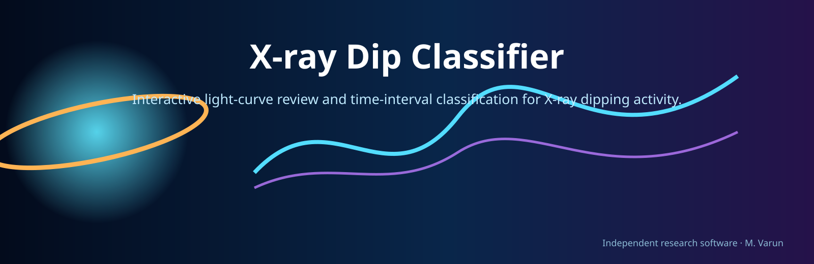

<p align="center"></p>

# X-ray Dip Classifier

[](https://github.com/varunastronomy/xray-dip-classifier/actions/workflows/quality-checks.yml)

Interactive light-curve review and time-interval classification for X-ray dipping activity.

> **Scientific boundary:** Selections are analyst-defined annotations, not an objective physical classification; visually inspect every saved interval and GTI.

## Copyright, permission, and mandatory citation

> **COPYRIGHT © 2026 M. VARUN, CHRIST (DEEMED TO BE UNIVERSITY), BENGALURU, INDIA. ALL RIGHTS RESERVED.**
>
> **NO PERMISSION IS GRANTED TO USE, COPY, MODIFY, REDISTRIBUTE, REPUBLISH, OR INCORPORATE THIS SOFTWARE INTO ANOTHER PROJECT WITHOUT PRIOR WRITTEN PERMISSION FROM THE AUTHOR. APPROVED USE REQUIRES CLEAR ATTRIBUTION AND CITATION.**

## Installation and use

```bash
python -m pip install -r requirements.txt
python xray_dip_classifier.py --help
```

Some interactive scripts do not implement `--help`; run them from a prepared analysis directory and follow their prompts. Read the source-level defaults before execution. Mission-specific programs additionally require the relevant mission software, calibration, network access, and data layout.

## Provenance and validation

The scientific source is copied from `Final_dip_classification.py` in the private research archive. The archived original remains unchanged. Repository checks validate Python syntax only. No real observation, mission pipeline, fit, download, plot suite, or scientific result was executed or validated for publication. Outputs must be inspected before scientific use.

No open-source license is granted. Citation metadata are in [`CITATION.cff`](CITATION.cff).

## Author

**M. Varun**<br>X-ray astronomy researcher and scientific Python developer<br>CHRIST (Deemed to be University), Bengaluru, India<br>[GitHub: varunastronomy](https://github.com/varunastronomy)
